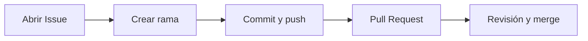

# Guía de contribución

Para preparar tu copia local del proyecto, sigue primero la sección [Instalación](README.md#instalación) del README.

## Flujo de contribución

## Cómo reportar un error

1. Revisa en la pestaña **Issues** que el error no haya sido reportado antes.
2. Abre un nuevo **Issue** con un título corto y claro, por ejemplo: `El total del carrito no considera la cantidad`.
3. En la descripción incluye:
   | Campo | Qué escribir |
   | :--- | :--- |
   | **Qué esperaba** | El resultado correcto. |
   | **Qué ocurre** | El resultado incorrecto. |
   | **Dónde** | Archivo, función y línea. |
   | **Cómo reproducirlo** | Pasos para ver el error. |
4. Agrega la etiqueta `bug`.

## Cómo proponer una mejora

1. Abre un **Issue** con la etiqueta `enhancement`.
2. Describe **qué quieres agregar o cambiar** y **por qué sería útil**.
3. Si puedes, propón cómo implementarlo.
4. Espera comentarios antes de empezar a programar, para confirmar que la idea encaja con el proyecto.

## Checklist antes de enviar un Pull Request

- [x] Trabajé en una rama nueva con nombre descriptivo (por ejemplo `fix/calcular-total`), no en `main`.
- [ ] Mi código funciona y lo probé en el navegador.
- [ ] No rompí funciones que ya existían.
- [ ] Los mensajes de commit son claros y describen el cambio.
- [ ] Actualicé la documentación (README) si mi cambio lo requiere.
- [ ] El Pull Request explica qué cambié y por qué.
- [ ] Enlacé el Issue relacionado (por ejemplo: `Closes #3`).

[Volver al README](README.md)