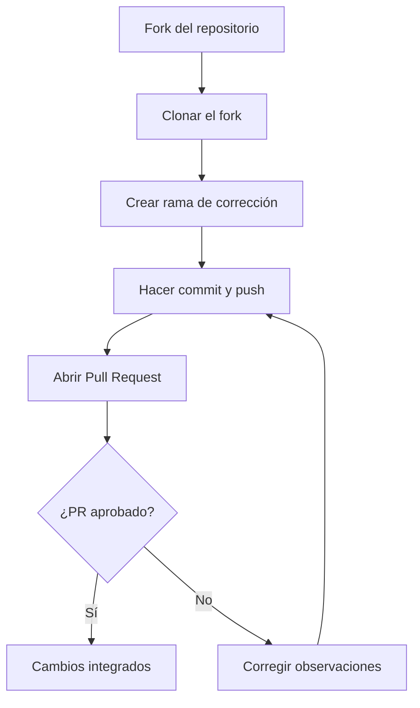
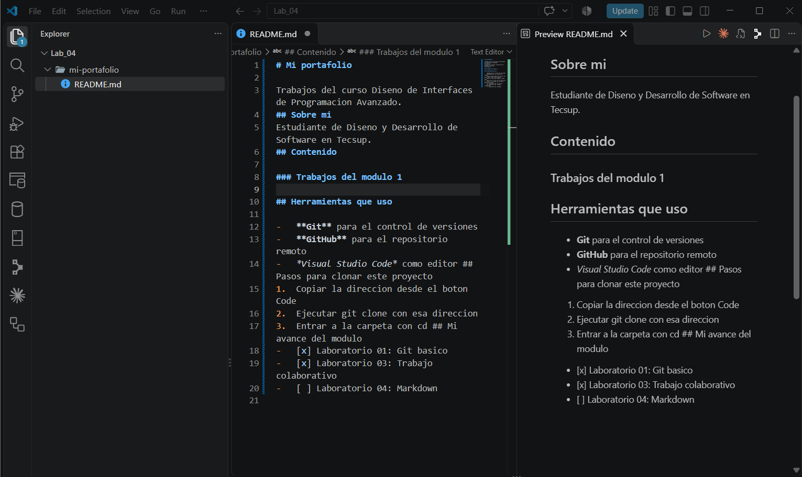

# Laboratorio 03: Trabajo Colaborativo con Git y GitHub


Proyecto del curso **Diseño de Interfaces de Programación Avanzado** que documenta cómo contribuir a un repositorio ajeno (tienda-tecsup) mediante Fork, ramas, Issues y Pull Requests, sin alterar el código base original. Está dirigido a estudiantes y desarrolladores que se inician en el trabajo colaborativo con Git.

> Documentar el proceso de trabajo colaborativo es fundamental para asegurar la calidad y la trazabilidad del código en un equipo de desarrollo.

## Tabla de contenidos

- [Requisitos](#requisitos)
- [Instalación](#instalación)
- [Uso](#uso)
- [Archivos y comandos principales](#archivos-y-comandos-principales)
- [Flujo de trabajo](#flujo-de-trabajo)
- [Hoja de ruta](#hoja-de-ruta)
- [Evidencia del proyecto](#evidencia-del-proyecto)
- [Contribución](#contribución)

## Requisitos

- **Git** instalado y configurado en el equipo local.
- Editor de código **Visual Studio Code**.
- Cuenta activa en [GitHub](https://github.com).
- Acceso al repositorio base del docente: [tienda-tecsup](https://github.com/jeisson-tecsup/tienda-tecsup).

## Instalación

1. Realiza un **Fork** del repositorio original desde la web de GitHub hacia tu cuenta.
2. Clona tu fork y entra a la carpeta del proyecto:

```bash
git clone https://github.com/jeisson-tecsup/tienda-tecsup
cd tienda-tecsup
```

3. Verifica que el remoto apunte a tu propio fork:

```bash
git remote -v
```

## Uso

Crea una rama dedicada para tu corrección, haz tus cambios y publícalos:

```bash
git checkout -b fix/calcular-total
git add script.js
git commit -m "fix: considerar la cantidad de cada producto en calcularTotal"
git push origin fix/calcular-total
```

Corrección implementada en la función `calcularTotal` de `script.js`:

```javascript
function calcularTotal(lista) {
  let total = 0;
  for (const producto of lista) {
    total = total + producto.precio * producto.cantidad;
  }
  return total;
}
```

Finalmente, abre un **Pull Request** desde tu rama hacia el repositorio original.

## Archivos y comandos principales

| Elemento / Comando | Tipo | Descripción |
| :--- | :---: | :--- |
| `script.js` | Archivo | Lógica del carrito de compras y cálculo del total. |
| `index.html` | Archivo | Estructura web principal que vincula el CSS y el JS. |
| `git checkout -b <rama>` | Comando | Crea una rama nueva e ingresa a ella para aislar los cambios. |
| `git push origin <rama>` | Comando | Publica la rama en tu fork de GitHub. |

## Flujo de trabajo



## Hoja de ruta

- [x] Identificación y reporte del fallo mediante un *Issue* en el repositorio base.
- [x] Corrección del error en una rama dedicada y envío del *Pull Request*.
- [ ] Implementación de integración continua (CI/CD) para pruebas automáticas.

## Evidencia del proyecto



## Contribución

Las contribuciones son bienvenidas. Lee la [guia de contribucion](CONTRIBUTING.md) antes de enviar cambios.