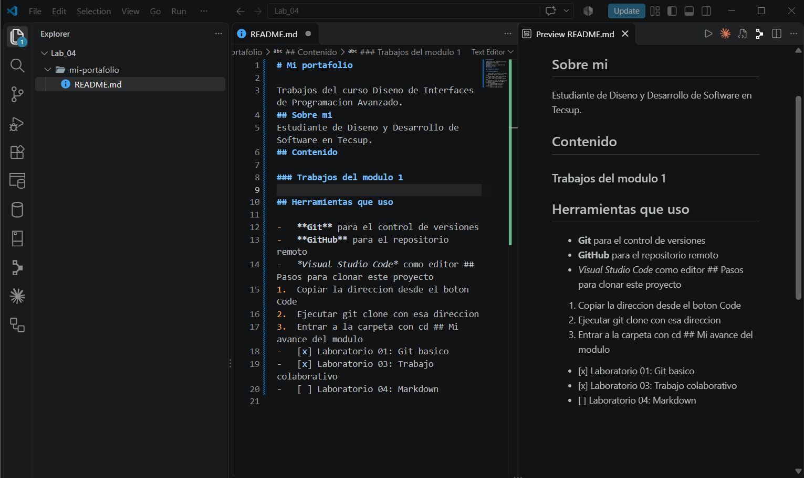

# Guía del Laboratorio 03: Trabajo Colaborativo con Git y GitHub

Esta guía documenta la gestión y el flujo de trabajo colaborativo desarrollado durante el Laboratorio 03 del curso Diseño de Interfaces de Programación Avanzado. Está redactada para explicar el procedimiento paso a paso a cualquier desarrollador que revise este repositorio.

> Documentar el proceso de trabajo colaborativo es fundamental para asegurar la calidad y la trazabilidad del código en un equipo de desarrollo.

## Introducción y Requisitos

El objetivo principal de este proyecto es aprender a contribuir en un repositorio ajeno mediante el flujo estándar de Git sin alterar el código base original.

### Prerrequisitos de Software

* Tener instalado y configurado **Git** en el sistema local.
* Editor de código **Visual Studio Code**.
* Cuenta activa en la plataforma [GitHub](https://github.com).
* Acceso al repositorio base del docente ([tienda-tecsup](https://github.com/jeisson-tecsup/tienda-tecsup.git)).

---

## Pasos de Instalación y Uso

Sigue estas instrucciones en tu terminal para obtener una copia de trabajo en tu equipo:

1. Realiza un **Fork** del repositorio original desde la web de GitHub hacia tu cuenta personal.
2. Clona tu repositorio forkeado ejecutando el comando correspondiente en tu terminal.
3. Navega hacia la carpeta del proyecto para revisar y editar el código.

Para verificar que tu remoto local apunta a tu propio fork, ejecuta el comando `git remote -v`.

---

## Archivos y Comandos Principales

A continuación se describen los archivos clave analizados y los comandos principales empleados en esta práctica:

| Elemento / Comando | Tipo | Descripción |
| :--- | :--- | :--- |
| `script.js` | Archivo | Contiene la lógica del carrito de compras y la función para calcular el total. |
| `index.html` | Archivo | Estructura web principal donde se vinculan los estilos CSS y el script de JS. |
| `git checkout -b <rama>` | Comando | Crea una nueva rama de trabajo e ingresa a ella para aislar los cambios. |

---

## Bloque de Código de Ejemplo

A continuación se muestra la corrección implementada en la función `calcularTotal` de `script.js` para considerar las cantidades de cada producto:

```javascript
function calcularTotal(lista) {
  let total = 0;
  for (const producto of lista) {
    total = total + producto.precio * producto.cantidad;
  }
  return total;
}
```

---

## Lista de Tareas del Proyecto

Estado de las entregas y metas alcanzadas durante la realización del laboratorio:

- [x] Identificación y reporte del fallo mediante un *Issue* en el repositorio base.
- [x] Corrección del error en una rama dedicada y envío del *Pull Request*.
- [ ] Implementación de integración continua (CI/CD) para pruebas automáticas.

---

## Evidencia del Proyecto

